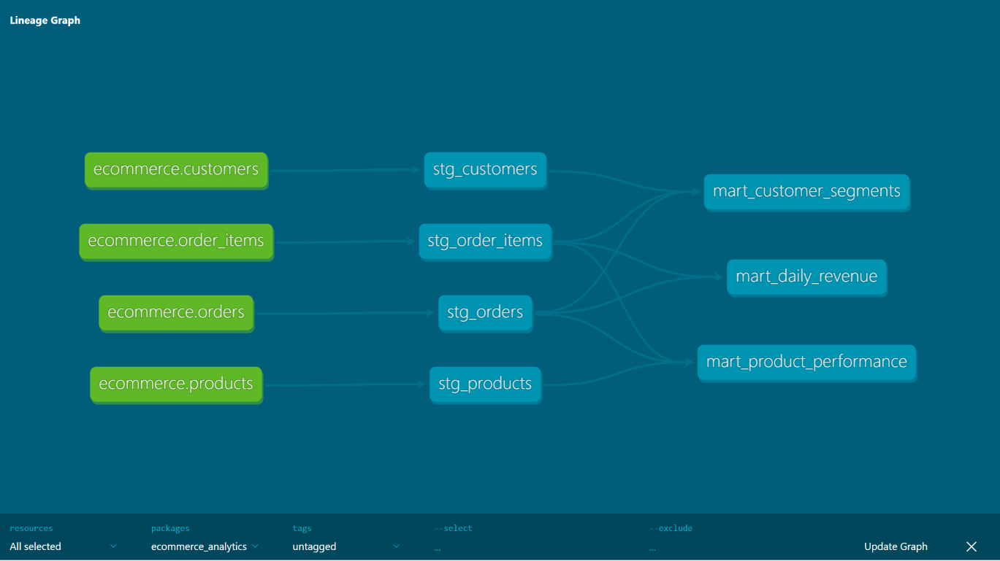
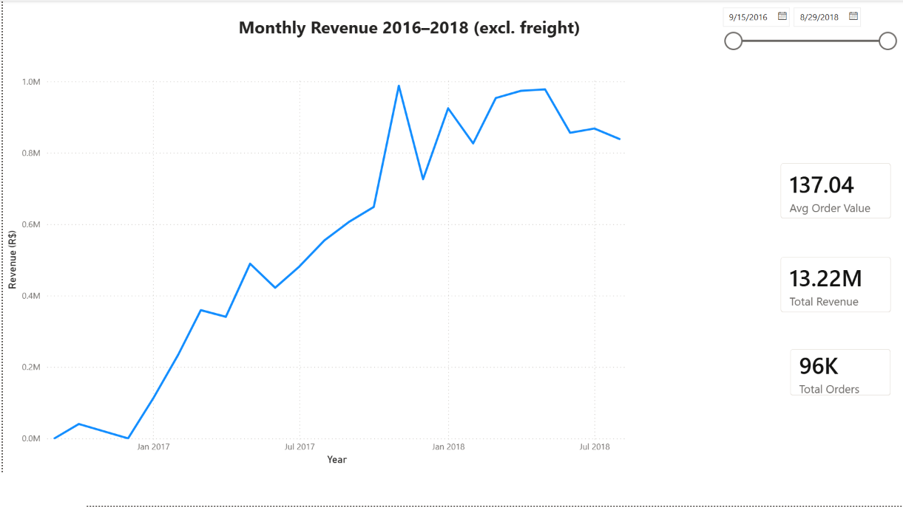
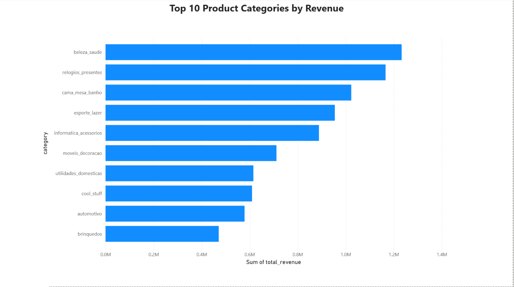
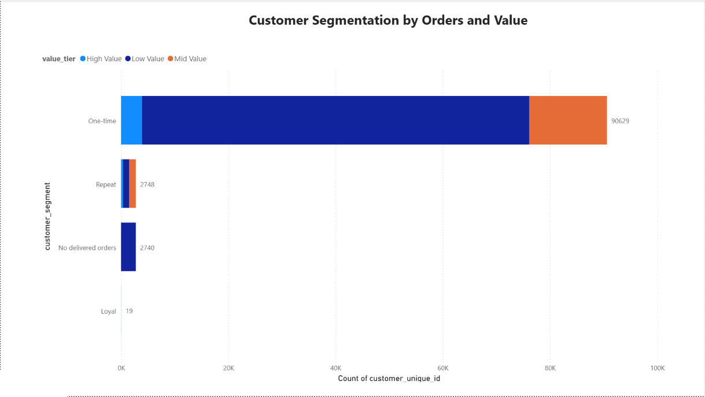

# Brazilian E-Commerce Analytics Pipeline

[](https://github.com/Arushi-dev/ecommerce-analytics-dbt/actions/workflows/dbt-ci.yml)

An end-to-end analytics engineering project on the public Olist Brazilian E-Commerce dataset. It runs from raw CSVs through tested dbt models to Power BI and Tableau dashboards.

**Business question:** How is revenue developing, which product categories drive it, and how many customers come back after their first order?

## Stack
- **DuckDB**: local analytical database
- **dbt Core** (dbt-duckdb adapter): transformations, sources, tests
- **Power BI**: DAX measures, row-level security, bookmark navigation
- **Tableau Public**: revenue and product views

## Architecture

```
Olist CSVs (orders, customers, order_items, products)
   ↓  loaded into DuckDB (raw schema: main)
   ↓  dbt staging models: type casting, filtering, standardising
   ↓  dbt mart models: business logic and KPIs
Power BI report (3 pages) · Tableau dashboards
```

## dbt models

| Model | Layer | Description |
|---|---|---|
| `stg_orders` | Staging | Orders with dates cast; excludes cancelled and unavailable orders |
| `stg_customers` | Staging | Customer IDs, unique customer ID, city and state |
| `stg_order_items` | Staging | Line items with price, freight and total item value; excludes zero-price lines |
| `stg_products` | Staging | Products with missing categories set to `unknown` |
| `mart_daily_revenue` | Mart | Daily orders, revenue and freight for delivered orders |
| `mart_product_performance` | Mart | Revenue, orders and unique products per category |
| `mart_customer_segments` | Mart | Orders and lifetime value per unique customer, with segment and value tier |

## Data quality
12 dbt tests, all passing:
- **10 schema tests** on the staging models: `unique` on `order_id` and `product_id`, and `not_null` on all key identifier fields.
- **`accepted_values`** on `customer_segment`: only the four defined segments may appear.
- **`assert_segment_matches_order_count`**, a business-logic test: every customer's segment must agree with their delivered order count. This is the test that would have caught the segment bug described below, which passed all the schema tests.

## Continuous integration (CI)
Every push to `main` and every pull request runs a GitHub Actions workflow ([`.github/workflows/dbt-ci.yml`](.github/workflows/dbt-ci.yml)):
1. Starts a clean Linux machine and installs the pinned dbt versions.
2. Loads a small hand-made test dataset ([`ci/fixtures/`](ci/fixtures/)) into a fresh DuckDB file. The rows cover the edge cases: a repeat customer, a customer with only a cancelled order, an order not yet delivered, a zero-price line and a product with no category.
3. Runs `dbt build`, which builds every model and runs every test.

If any model fails or any test fails, the run fails and the commit gets a red cross. The real Olist data is too large for Git, so CI checks the logic on the fixtures, and the full dataset is built locally.

## Power BI report
- DAX measures: Total Revenue, Total Orders, Average Order Value, Month-on-Month Growth (`PREVIOUSMONTH`)
- Row-level security by `customer_state`
- Bookmark navigation across three pages: Revenue Trend, Product Performance, Customer Segments

## Key findings (from the mart tables)
- **Revenue:** R$13.2M in item revenue from 96,478 delivered orders (Sep 2016 – Aug 2018), an average order value of R$137 excluding freight.
- **Black Friday:** November 2017 revenue was R$988k, 52% above October 2017.
- **Retention is the biggest opportunity:** 97% of customers with a delivered order bought only once. Repeat customers (2–4 orders) have an average lifetime value of R$305, against R$161 for one-time buyers.
- **Top categories by revenue:** health & beauty, watches & gifts, and bed, bath & table.

## Screenshots

**dbt lineage:** four raw sources → four staging models → three marts.



**Monthly revenue 2016–2018**, with the November 2017 Black Friday peak.



**Top 10 product categories by revenue.**



**Customer segments** after the segment fix: One-time 90,629 · Repeat 2,748 · No delivered orders 2,740 · Loyal 19.



## Data quality fix
The first version of `mart_customer_segments` classified every customer with no delivered order as "Loyal", because `total_orders = 0` fell through to the `else` branch of the segment `CASE`. That put 2,740 customers in the Loyal segment, which really has 19. A dedicated "No delivered orders" segment now handles them.

## Design notes
- `customer_unique_id`, not `customer_id`, identifies a person. Olist issues a new `customer_id` for every order, so repeat-purchase analysis must group on `customer_unique_id`.
- Revenue marts filter to `delivered` orders, so revenue reflects completed sales.

## Run it yourself
1. Download the dataset from Kaggle: *Brazilian E-Commerce Public Dataset by Olist*.
2. Load `olist_orders_dataset`, `olist_customers_dataset`, `olist_order_items_dataset` and `olist_products_dataset` into a DuckDB database as tables `orders`, `customers`, `order_items` and `products`.
3. Point a `duckdb` profile named `ecommerce_analytics` in `~/.dbt/profiles.yml` at that database file.
4. Run `dbt build`.

To run the CI checks locally instead: `python ci/load_fixtures.py` then `dbt build --profiles-dir ci`.

## Dataset
Olist Brazilian E-Commerce Public Dataset: 99,441 orders, 112,650 order items, 32,951 products, 2016–2018.

## Portfolio
[Portfolio](https://arushi-sharma.notion.site/Hey-there-I-am-Arushi-318d5a056b7080bea33edb8dc09f7d61) · [GitHub](https://github.com/Arushi-dev)
